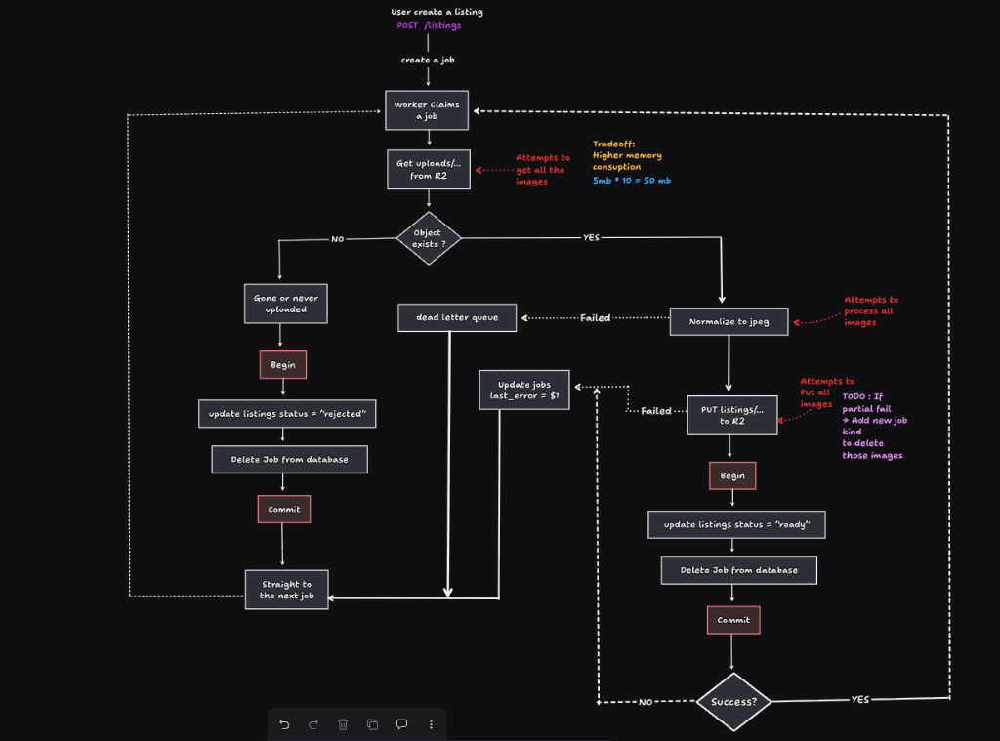
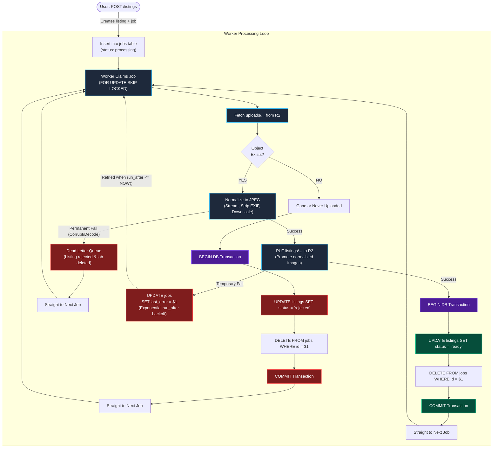

# Resell Marketplace APIs

A high-performance backend API for a peer-to-peer secondhand marketplace built with **Go**, **PostgreSQL**, and **Cloudflare R2**.

---

## Image Upload & Worker Architecture

The application implements an asynchronous **Transactional Outbox Pattern** with a background worker engine to handle image uploads, validation, normalization, and lifecycle management without blocking user requests.



<details>
<summary><b>Click to view interactive Mermaid flowchart</b></summary>



</details>

---

### Step-by-Step Architecture Breakdown

#### 1. Upload & Job Creation (`POST /listings`)
1. Client requests presigned upload URLs for raw user uploads (`uploads/<user-id>/<uuid>.<ext>`).
2. Client uploads images directly to Cloudflare R2 via presigned PUT.
3. Client submits `POST /listings`.
4. Inside a single database transaction:
   * Listing record is inserted with `status = 'processing'`.
   * Image metadata records are inserted into `images`.
   * An image processing job is queued into `jobs` table (`kind = 'process_listing_images'`).

#### 2. Worker Claiming (`FOR UPDATE SKIP LOCKED`)
* Multiple workers concurrently poll the `jobs` queue without race conditions or head-of-line blocking using:
  ```sql
  UPDATE jobs 
  SET attempts = attempts + 1,
      run_after = NOW() + LEAST(INTERVAL '30 seconds' * POWER(2, attempts), INTERVAL '1 hour')
  WHERE id = (
      SELECT id FROM jobs 
      WHERE run_after <= NOW() AND attempts < 4
      ORDER BY run_after, id
      FOR UPDATE SKIP LOCKED 
      LIMIT 1
  )
  RETURNING id, kind, payload, attempts;
  ```

#### 3. Image Verification & Streamed Normalization
* **Fetch (`uploads/...`)**:
  * If object is missing (`storage.ErrNotFound`): The upload was abandoned. An atomic transaction updates listing `status = 'rejected'` and deletes the job.
* **Normalize to JPEG**:
  * Streams raw image bytes directly into `imaging.Normalize` (avoids buffering all images simultaneously in RAM).
  * Strips EXIF metadata to protect user privacy.
  * Downscales images to max bounding edge (e.g. 2048px) maintaining aspect ratio.
  * Re-encodes cleanly to JPEG with quality 85.
  * **Permanent failure**: If decoding fails (corrupted file/payload), job is routed to `deadLetterJob` to reject the listing immediately.

#### 4. Promotion to Permanent Storage (`listings/...`)
* Normalized images are uploaded to their permanent destination (`listings/<listing-id>/<uuid>.jpeg`).
* **Transient failure**: If R2 upload fails (e.g. network blip), the job updates `last_error` and is scheduled for exponential backoff retry via `run_after`.

#### 5. Completion Transaction
* Upon successful promotion of all images:
  * Database transaction opens.
  * Listing status is updated to `status = 'ready'`.
  * Job is removed from the `jobs` table.
  * Transaction commits atomically.
  * Worker immediately proceeds to claim the next job.
